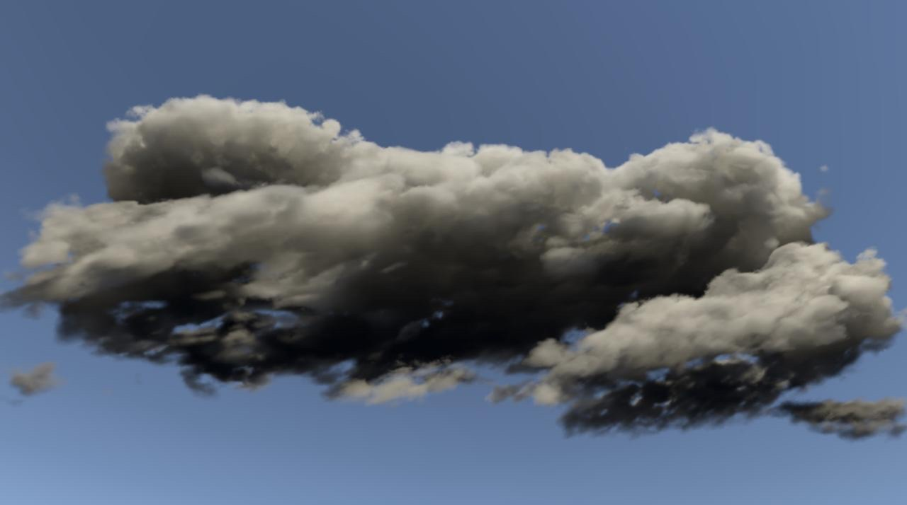
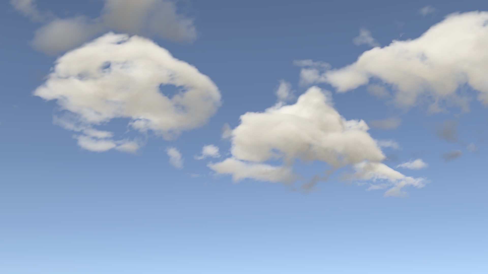
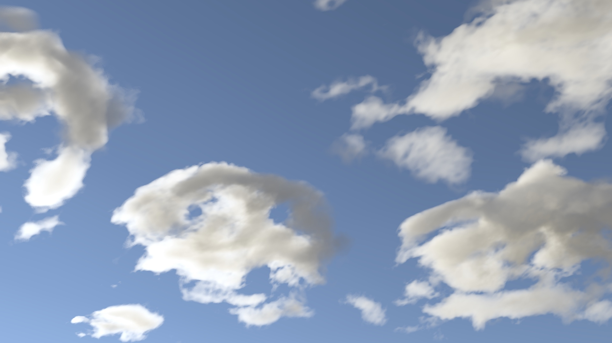

# Tansen

A physics-based GPU cloud simulation and volumetric renderer in Unity. The ground heats and moistens the air, thermals rise, cool and condense, and the resulting cloud water is ray-marched with physically based lighting. Some renders from the project:

*Cumulonimbus (thundercloud)*

| From the ground | Sun ahead, low |
|---|---|
|  |  |

## Notes

[`docs/DEV_NOTES.md`](docs/DEV_NOTES.md) is the development log.
